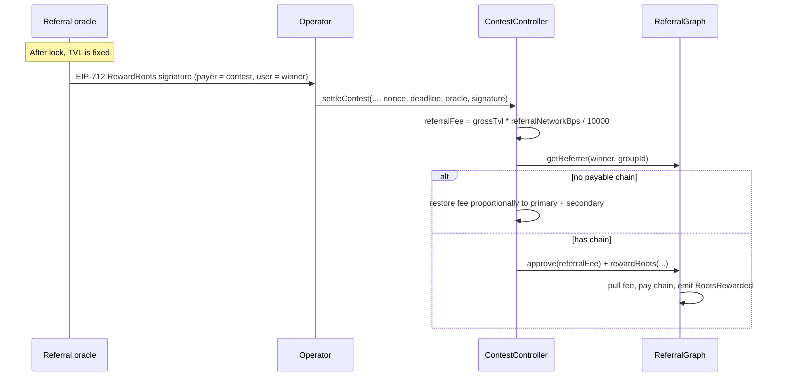

# Referral Network Integration

Replace claim-time oracle fees with settlement-time referral network fees (`referralNetworkBps`), integrated with [referralTree](https://github.com/MagRelo/referralTree) v2 (`ReferralGraph.rewardRoots` + `RewardCalculator`). At settlement, the fee is deducted from distributable TVL and paid up the **primary winner's referrer chain**. The primary winner is the lookup key only and is **not** a referral-fee recipient. That entry is the `winningEntries` member with the largest `payoutBps` (the earlier entry on a tie), not `secondaryWinner`.

**Implemented:** [`ContestController.sol`](src/ContestController.sol) uses `referralNetworkBps` (5% standard), deducts the fee once at settlement from total distributable TVL, and calls `rewardRoots` when the winner has a payable referrer chain. Otherwise it restores the fee proportionally to the primary and secondary pools. Claims/pushes pay **full net amounts** with no further fee deduction. After push batches, unallocated wei (no claimable owner) is credited into the secondary winning pool (or the first still-owed primary payout) so claimants receive it — never transferred to the contest operator. `paymentToken`, `operator`, `referralGraph`, `rewardCalculator`, and `referralGroupId` are factory-level immutables (set once on [`ContestFactory`](src/ContestFactory.sol) deploy).

The graph owner must call `setRewardCalculator` before any paying settlement. `rewardRoots` reverts with `RewardCalculatorNotSet` until that is done.

## Flow

## Config

| Field | Notes |
| --- | --- |
| `ContestFactory.paymentToken` | Factory immutable; copied into each contest |
| `ContestFactory.operator` | Factory immutable; copied into each contest |
| `ContestFactory.referralGraph` | Factory immutable; copied into each contest |
| `ContestFactory.rewardCalculator` | Factory immutable; copied into each contest. Payouts use the calculator set on the graph |
| `ContestFactory.referralGroupId` | Factory immutable; copied into each contest |
| `ContestController.referralNetworkBps` | Max 1000 (10%) |

`referralRewardId(nonce)` is `keccak256(abi.encode("contest-catalyst", address(contest), nonce))`. Nonce `0` is the usual id. It shares the group's reward-id namespace with every other `rewardRoots` / `rewardLeaf` caller.

The oracle signs EIP-712 `RewardRoots` (domain name `"ReferralGraph"`, version `"1"`) with:

- `user` = the primary winner (largest `payoutBps`). Ancestors above that owner are paid; the owner is not
- `payer` = the contest
- `token` = `paymentToken`
- `totalAmount` = the on-chain `referralFee`
- `rewardId` = `referralRewardId(nonce)`
- `deadline` inclusive

## Settlement behavior

1. Compute `referralFee` from gross primary + secondary TVL.
2. Shrink primary/secondary pools by `netBps = 10000 - referralNetworkBps`.
3. If `referralFee > 0`, `distributeReferralFee` runs via a self-call try/catch:
   - `getPayoutAncestors` of the primary winner is empty when that owner is unregistered, the referrer is `REFERRAL_ROOT`, or every ancestor is skiplisted. That restores the full fee proportionally (`toSecondary = fee * totalSecondary / totalGross`, remainder to primary) and does not call `rewardRoots`.
   - Otherwise approve the graph for exactly `referralFee` and call `rewardRoots`. The graph pulls that amount, takes any protocol fee out of it, and pays the geometric split of the remainder.
   - `InvalidSigner`, `SignatureExpired`, `RewardCalculatorNotSet`, and `RewardIdUsed` revert `settleContest`. The operator resubmits. A consumed id needs a new `referralNonce` and a matching signature.
   - Any other payout failure restores the full fee proportionally and settlement continues.

`rewardRoots` pays skiplist-aware ancestors above `user` and does not pay `user`. The contest passes the primary winner, so the referral fee goes to that owner's referrers.

**Protocol fee:** the graph owner can set `feeBps` up to 1000 (10% of `referralFee`, default 0). That slice goes to `feeRecipient`. Prize pools still lose only `referralNetworkBps`. Referrers receive the remainder.

## Trust assumptions

- Contest `operator` is a trusted escrow/ops agent (not an on-chain truth oracle): it unilaterally supplies settlement winners and splits. Prefer a multisig.
- Participants must also trust the factory deployer's chosen `ReferralGraph.owner` and the group's authorized oracles (referral-tree role, distinct from contest `operator`). The owner sets the calculator and the protocol fee. An authorized oracle registers referrers and signs `RewardRoots`. An oracle can register an unregistered winner under an attacker-controlled referrer before settlement redirects up to `referralNetworkBps` of TVL. Participants should register referrers before settle. Live `getReferrer` at settle (no lock-time snapshot) is intentional.
- `paymentToken` must be a standard ERC20 (no fee-on-transfer / rebasing).

## Tests

[`ReferralTestHarness.sol`](test/helpers/ReferralTestHarness.sol) deploys real `ReferralGraph` + `RewardCalculator`, calls `setRewardCalculator`, and signs `RewardRoots` inside `_settleContest` when a payable chain exists (default secondary winner is `winners[0]`, nonce `0`).

Key cases in [`ContestController.t.sol`](test/ContestController.t.sol):

- `test_settleContest_ReferralFeeDistributed` — referrer receives the geometric amount; `RootsRewarded` is emitted; winner balance is unchanged by the fee
- `test_settleContest_ReferralFeeZeroSkipsDistribution` — `referralNetworkBps = 0`
- `test_settleContest_UnregisteredWinner_FeeRestoredProportionally` — fee restored to primary and secondary by gross share
- `test_settleContest_SkiplistedAnchorRestoresFee` — empty payout chain restores the fee
- `test_settleContest_ExpiredReferralSignatureReverts` / `MismatchedReferralSignatureReverts` — settle reverts and stays `LOCKED`
- `test_settleContest_RewardIdUsedRetriesWithNewNonce` — a consumed nonce reverts; nonce `1` pays
- `test_settleContest_ProtocolFeeComesOutOfReferralFee` — graph fee is taken from the referral fee
- `test_settleContest_MaliciousCalculatorFallsBackProportionally` / `RevertingCalculatorFallsBackProportionally` / `UnderpayCalculatorRestoresFullFee` — graph calculator failure restores the full fee. `rewardRoots` requires an exact split, so an under-paying calculator does not pay a partial amount

## Indexing

`RootsRewarded` on the graph is the paid-out record (topic0 `0x512f243e2341cf5ab027a0083e2ca39dfc9b5a73f0727598392c821d165a4235`). `distributedAmount` is net of the protocol fee. When the fee is non-zero the same call also emits `ProtocolFeeCharged` (topic0 `0xa73da5e7dfa923f7b03d92bb9fb864d6efaf22f95a7fd46f7e475c56f7e5ca92`), and `distributedAmount + ProtocolFeeCharged.amount == referralFee`.

The contest also emits:

- `ReferralNetworkFeeDistributed` — gross `amount` is the fee that left the prize pools; `amounts` mirror the net split when the calculator view succeeds
- `ReferralNetworkFeeToPrimary` — no payable chain, or a payout failure restored the fee across both pools

`UserRegistered` is now `UserRegistered(bytes32 indexed groupId, address indexed user, address indexed referrer)`. Listeners of the v1 event (no `groupId`) must be updated.
